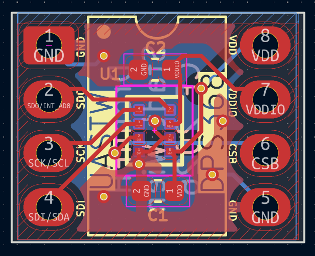
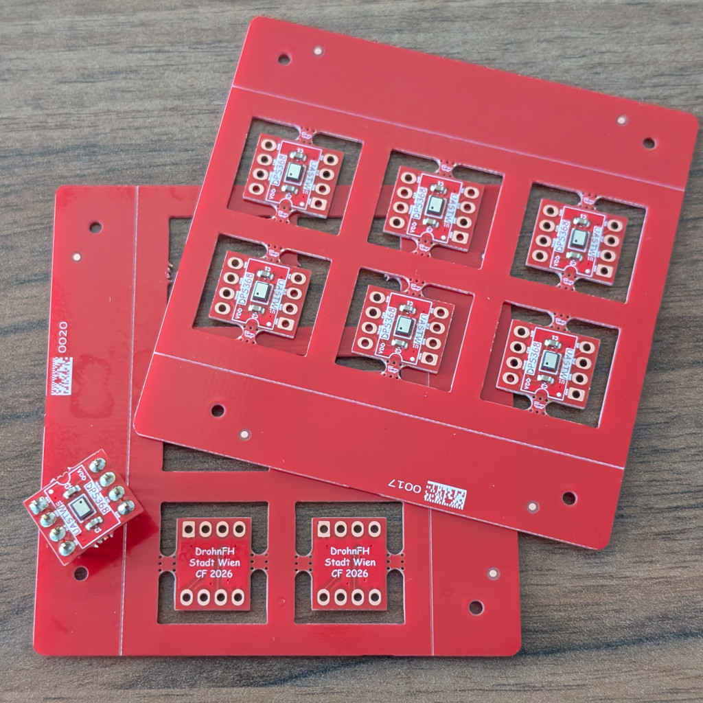
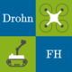

== DrohnFH DPS368 Breakout Board

This breakout board connects all the pins of the Infineon DPS368 barometric pressure sensor IC to a DIP-8 *W10.16 mm* footprint.

It is pin compatible with the break-off sensor section of the KIT DPS368 2GO board (see https://www.infineon.com/evaluation-board/KIT-DPS368-2GO)

[frame="none",grid="none",cols="^.^4,^.^9,width="100%"]
|====
|  | 
|====

WARNING: To keep routing as simple as possible, it does *not* follow the
conventional DIP pin assignment! Please use the connection diagrams below
to connect the breakout board correctly.

WARNING: When replacing a KIT DPS368 2GO sensor, disregard the orientation of the silkscreen
and match the VDD pin of the breakout board (top right corner) to the VDD pin on your target board.
This is due to multiple silkscreen revisions of the KIT DPS368 2GO board with different orientations existing.

The breakout board's pin assignment can be found in its link:datasheet/datasheet.pdf[Datasheet].

For further details see the sensor's datasheet (https://www.infineon.com/assets/row/public/documents/30/49/infineon-dps368-datasheet-en.pdf)

=== Acknowledgement

This work was supported by the City of Vienna via the project 
_Stadt Wien Kompetenzteam für Drohnentechnik in der Fachhochschulausbildung_,
MA23 Projekt Nr. 35-02.

[grid="none",frame="none"]
|====
|  |  | 
|====
